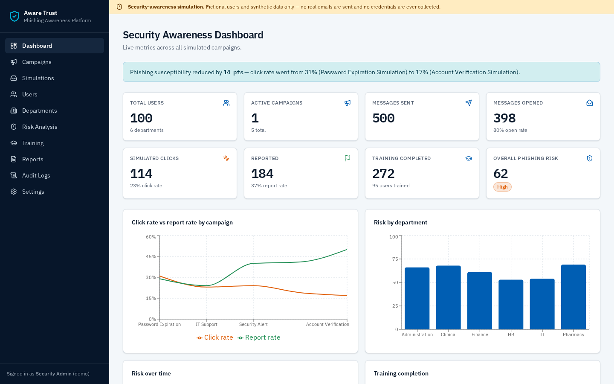
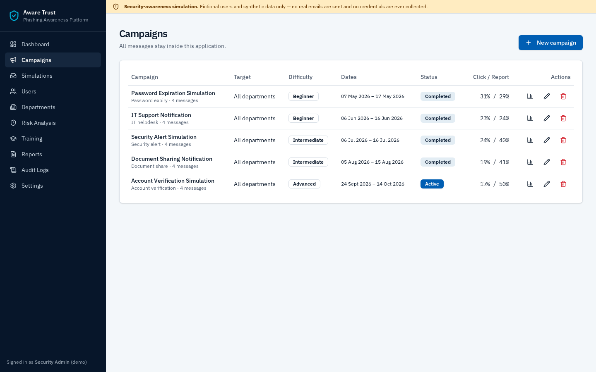
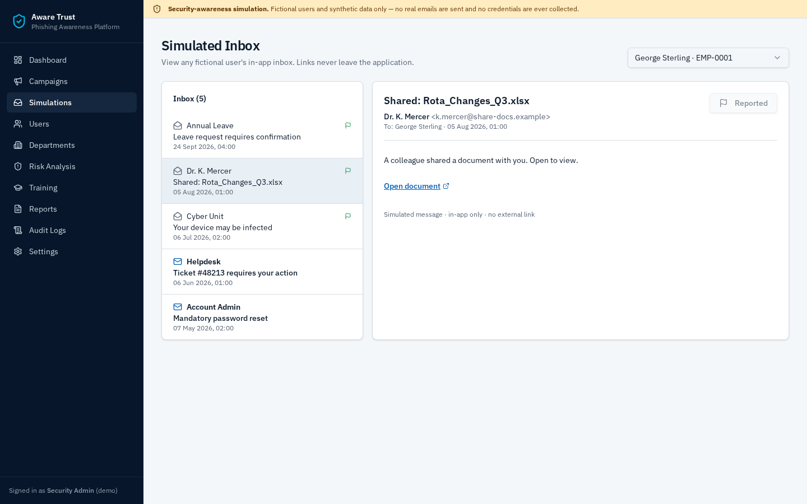
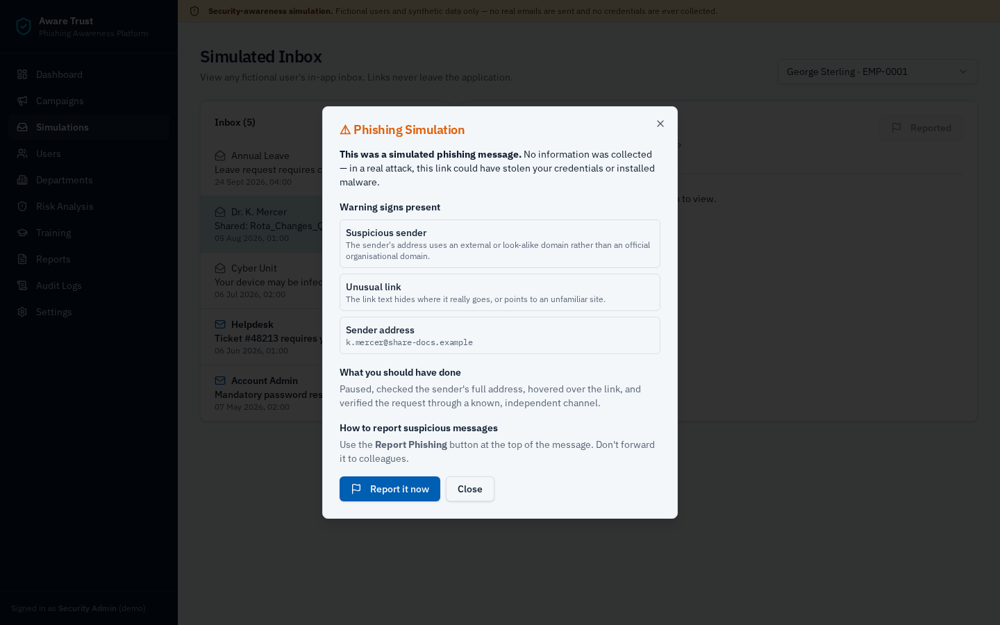
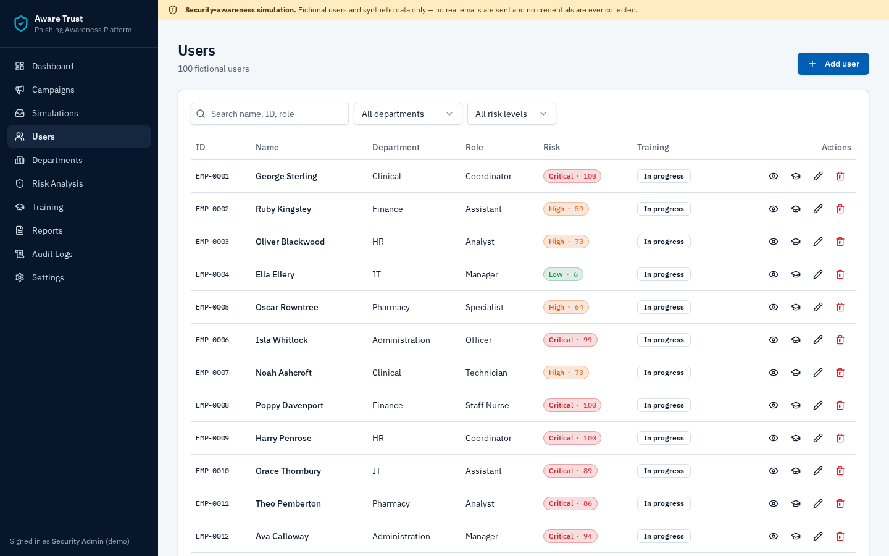
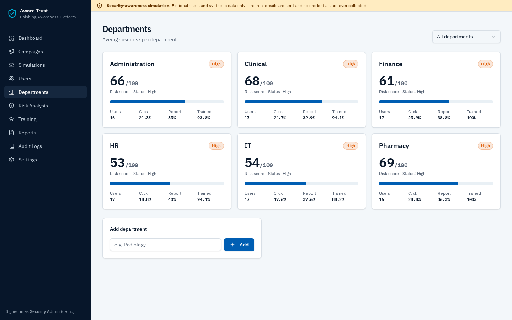
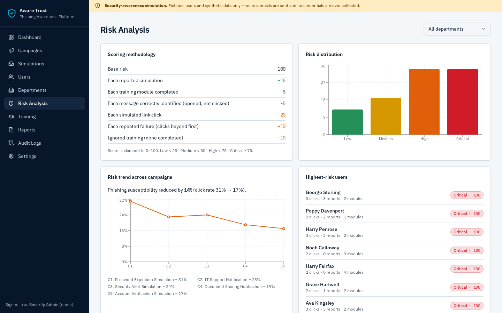
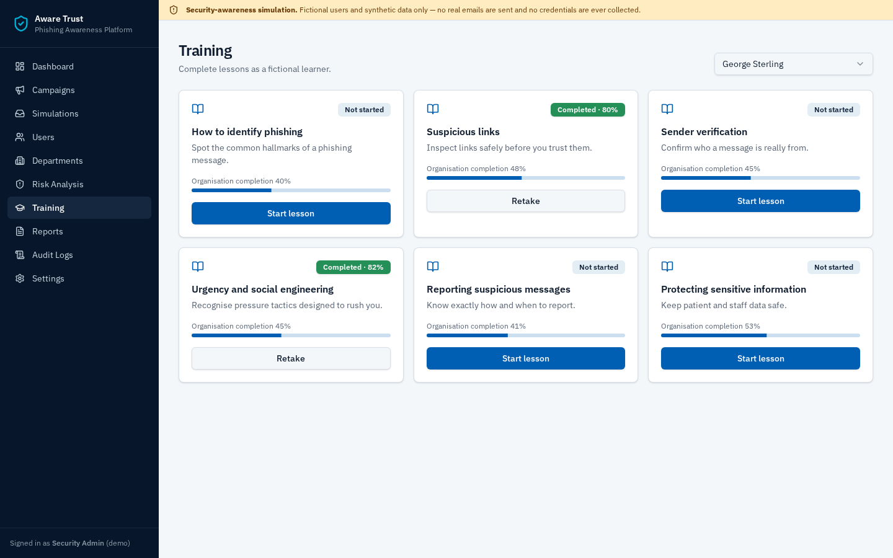
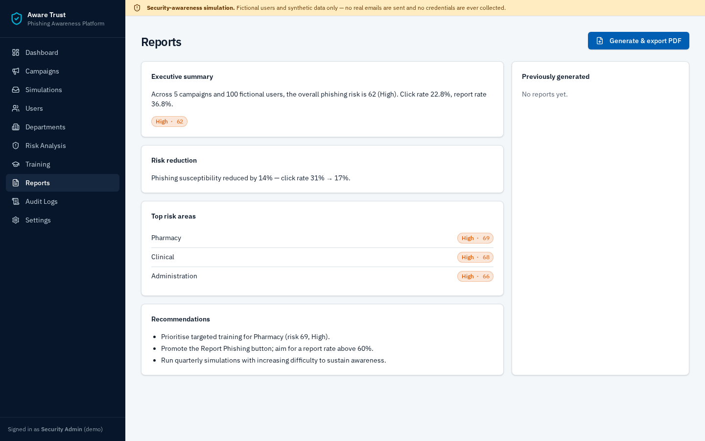
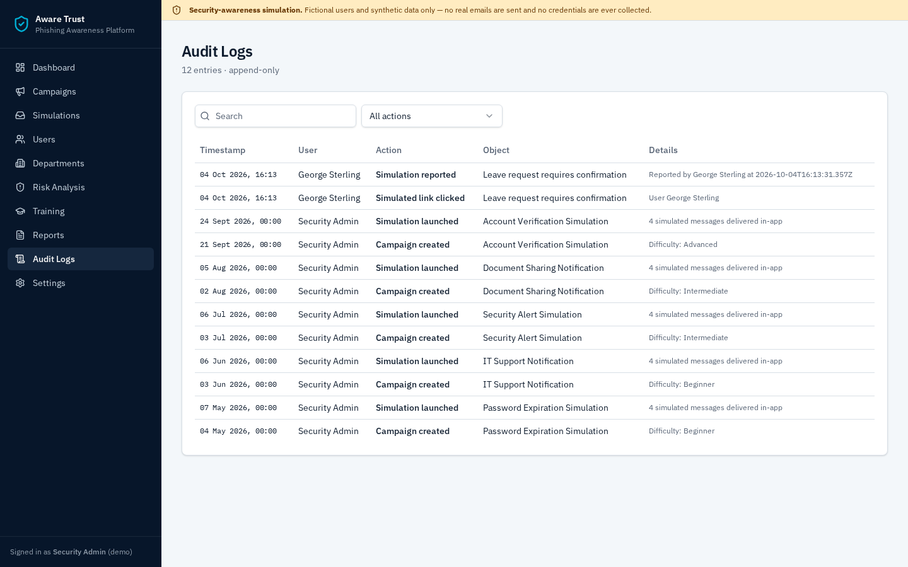

<div align="center">

# Aware Trust — Phishing Simulation & Awareness Platform

**A safe, enterprise-style cybersecurity-awareness platform for running simulated phishing campaigns in a fictional NHS-style organisation.**

     



</div>

> **Disclaimer:** This project is a cybersecurity-awareness simulation using fictional users and synthetic data. It does not send real phishing emails, collect credentials, interact with real NHS systems, or target real users.

---

## Contents
- [Purpose & objectives](#purpose--objectives)
- [Features](#features)
- [Screenshots](#screenshots)
- [Architecture](#architecture)
- [Data model](#data-model)
- [Risk methodology](#risk-methodology)
- [Getting started](#getting-started)
- [Security considerations](#security-considerations)
- [Limitations & future improvements](#limitations--future-improvements)

## Purpose & objectives
Organisations face most breaches through people, not technology. This platform shows how a security team can:

1. Run **simulated** phishing campaigns entirely inside the application.
2. Measure behaviour: opens, simulated clicks and reports.
3. Teach people at the moment they make a mistake, then follow up with short training.
4. Quantify **human cyber-risk** per user and department, and track it across campaigns.
5. Produce executive-ready PDF reports with an audit trail.

## Features
| Area | What it does |
|---|---|
| **Dashboard** | 8 KPIs plus charts for click and report rate, department risk, risk over time, training completion and campaign performance |
| **Campaigns** | Create, edit, delete and launch campaigns (scenario, target department, difficulty, dates, status). View per-campaign results |
| **Simulated inbox** | Per-user in-app inbox. Clicking a link shows a teaching screen explaining the warning signs instead of asking for credentials |
| **Report Phishing** | Logs the user, the simulation, the time and the action, then confirms "The message has been reported to the security team" |
| **Users** | Fictional users with search and filters, a risk badge, training status, campaign history, the risk calculation and training assignment |
| **Departments** | Risk score, status, click rate, report rate and training coverage for each department |
| **Risk Analysis** | A clear explanation of how scores are worked out, the spread of risk levels, the highest-risk users and the trend across campaigns ("susceptibility reduced by X%") |
| **Training** | Six lessons with explanations, examples, a mini quiz, scores and completion tracking |
| **Reports** | Executive summary, campaign overview, behaviour, department risk, trends, training, recommendations and risk reduction, plus PDF export |
| **Audit Logs** | Append-only log of admin and simulation actions, with search and filters |

## Screenshots
| | |
|---|---|
| **Campaigns**<br> | **Simulated inbox**<br> |
| **Teaching screen after a simulated click**<br> | **Users and risk**<br> |
| **Department risk**<br> | **Risk analysis**<br> |
| **Training**<br> | **Reports**<br> |
| **Audit logs**<br> | |

## Architecture
```text
React 19 + TanStack Start (Vite)  ──►  PostgreSQL (managed, row-level security)
 ├─ src/routes/*        pages (dashboard, campaigns, simulations, …)
 ├─ src/lib/data.ts     typed data access, paginated reads, audit + interaction writes
 ├─ src/lib/analytics.ts risk / campaign / department calculations (pure functions)
 ├─ src/lib/content.ts  scenario templates, phishing indicators, lessons & quizzes
 └─ drizzle/migrations  schema, constraints, policies and seed data
```
- **UI:** Tailwind CSS v4 design tokens, shadcn/ui, lucide icons, IBM Plex typography
- **Charts:** Recharts · **Validation:** Zod + database CHECK constraints · **PDF:** jsPDF + autotable

## Data model
`departments` · `staff_users` · `campaigns` · `simulation_messages` · `user_interactions` (delivered / opened / clicked / reported) · `training_modules` · `training_attempts` · `reports` · `audit_logs`

Risk scores are **calculated live** from the interactions, so every chart reflects the real data in the database.

**Seed data:** 100 fictional users, 6 departments (Clinical, IT, Finance, HR, Administration, Pharmacy), 5 campaigns, 20 simulated messages, 6 training modules, about 1,500 interaction records and past training attempts. Seeded click rates fall from campaign to campaign, so the trends show visible improvement.

## Risk methodology
| Factor | Weight |
|---|---|
| Base risk | 100 |
| Each reported simulation | −15 |
| Each training module completed | −8 |
| Each message correctly identified (opened, not clicked) | −5 |
| Each simulated link click | +20 |
| Each repeated failure (clicks after the first) | +10 |
| Ignored training (no modules completed) | +10 |

Scores are clamped to 0–100. **Low** < 25 · **Medium** < 50 · **High** < 75 · **Critical** ≥ 75. A department's score is the average of its users' scores.

## Getting started
```bash
npm install
npm run dev
```
Copy `.env.example` to `.env` and fill in your database URL and public key. Apply the SQL migration in `drizzle/migrations/` to a PostgreSQL database to create the schema and demo data.

## Security considerations
- No credential or password fields anywhere. Simulated links never leave the app, and nothing is emailed.
- Input is validated with Zod in the forms and enforced by database constraints (lengths, allowed values, date order).
- Row-level security is enabled on every table. Audit logs are append-only (updates and deletes are revoked).
- The data model is ready for roles. The demo runs in open "Security Admin" mode.

## Limitations & future improvements
- Demo access is open. Next step: admin sign-in with a separate roles table.
- Risk weights are fixed in code. They could be made editable per organisation.
- Planned: an indicator editor for each message, scheduled campaigns, and export to a learning management system (LMS).

---
<sub>Educational portfolio project demonstrating cybersecurity awareness, human-risk management, security analytics, reporting and defensive security skills.</sub>
